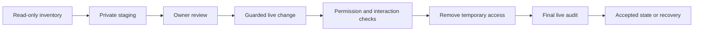

# HypBot Discord Server Builder

I built HypBot to make Discord server changes reviewable, reversible, and easier to verify. The project uses one owner-controlled Discord application with isolated profiles for each approved server. It separates private staging, live changes, verification, and recovery instead of treating one successful command as proof that the whole server is correct.

This public repository explains the architecture, permission model, privacy controls, and evidence I use. The live application source, server profiles, credentials, member data, and operational logs remain private.

## What I worked on

- Isolated server profiles that reject unknown guilds instead of borrowing another server's configuration.
- Private staging before a visible server change.
- Least-privilege permissions with Discord Administrator disabled.
- Idempotent panels and interactions so repeated deployment does not create duplicate controls.
- Restricted onboarding and role assignment with hierarchy checks.
- Content-free operational logging that does not copy message bodies.
- Verification for roles, channels, permissions, panels, interactions, and runtime health.
- Recovery procedures that preserve existing Discord history.
- PowerShell launch and credential-enrollment workflows that keep tokens outside source files.

## Workflow

The process closes three different gates:

1. The live server structure and permission state.
2. Real interactions and the active bot host.
3. A secret-free transfer package that can be verified on another computer.

## Verified results

The private HypBot 2.0.0 source passed 56 of 56 local automated tests on November 15, 2026. Those tests cover profile isolation, role hierarchy failures, least-privilege checks, idempotent access, project-brief handling, official-service music links, private status output, content-free logging, event serialization, and credential redaction.

The recorded Alpha live acceptance on November 13, 2026 passed 43 of 43 checks. The accepted state preserved channel history, kept legacy welcome history private, verified the bot online in its intended role group, removed temporary Manage Channels access, and did not delete user-authored messages or channels.

These results do not prove that every future Discord server or configuration will behave the same way. Each server still requires its own inventory, owner authorization, live tests, and final audit.

## Public repository map

- [Architecture](docs/ARCHITECTURE.md)
- [Permission model](docs/PERMISSION-MODEL.md)
- [Privacy and data handling](docs/PRIVACY.md)
- [Verification record](docs/VERIFICATION.md)
- [Security reporting](SECURITY.md)
- [Rights notice](LICENSE.md)

## What is intentionally excluded

- Bot tokens, encrypted credentials, and recovery material
- Guild, application, channel, role, message, and member IDs
- Member names and private server activity
- Live server profiles and owner notification details
- Private logs, local state, and machine-specific evidence
- The full application source and deployment scripts

The public repository is a technical case study. It is not a deployable copy of the private bot.

## Current state

The private application is active project work. This public package is prepared for portfolio review and has not been published to GitHub yet. Publication remains a separate owner action.

